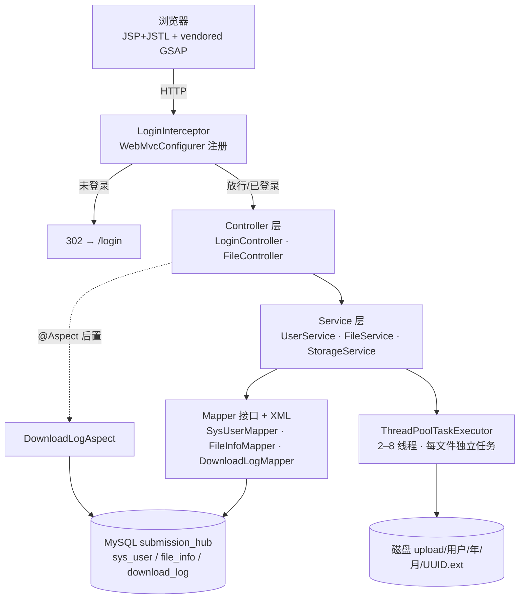

# 资料提交台 · 设计方案与实现规格

> 载体：`SSM实训案例任务书.docx`（V2.0 简化版，2 学时）
> 技术基线：Spring + Spring MVC + MyBatis（禁 Spring Boot）· JSP + JSTL · Maven · Tomcat 9 · MySQL 5.7+
> 视觉基线：`Desktop\Vibe Coding\useful\基于LLM\Skill\Gasp-Design`（GSAP 组件库，暗色高对比 + 绿/蓝/紫渐变）
> 本文件是动手前的唯一口径；与任务书冲突时，任务书的硬性条款优先。

---

## 0. 一句话定位

把任务书的"资料上传下载系统"做成一个**真正能演示、也拿得出手**的工作台：登录 → 多文件拖拽上传（服务端并发落盘）→ 按类型筛选的卡片列表 → 冻结/解冻 → 带下载次数统计的安全下载，全程 JSP 渲染 + 一段轻薄 GSAP 动效，不依赖外网 CDN。

拿分主线（对应任务书评分表）：

| 评分项 | 分值 | 本方案的落点 |
|---|---|---|
| 链路完整性 | 30 | 四条验收现象全部脚本化复验（见 §9） |
| 上传处理正确性 | 20 | 大小/类型服务端双校验、UUID 重命名、`upload/用户/年/月` 分目录、元信息 10 字段全填 |
| 下载与安全 | 25 | 按 ID + 归属查询取路径、canonical 前缀校验、`filename*=UTF-8''`、缺失/越权友好页 |
| 拦截器 | 15 | `WebMvcConfigurer#addInterceptors` 注册，放行含 `/static/**` |
| 交付规范 | 10 | README 可运行说明、SQL 脚本、关键设计注释、本规格文档 |

---

## 1. 脑暴：任务书没写死的地方，怎么取舍

任务书是简化版，但老师留了三处口头加料 + 用户两处加料，按"低风险高收益"逐条决策：

| 加料来源 | 内容 | 决策 | 理由 |
|---|---|---|---|
| 老师 | 支持同时多文件上传 | **做** | `<input multiple>` + `MultipartFile[]`，天然对验收无副作用 |
| 用户 | 多线程/并发响应 | **做，但收边界** | 有界 `ThreadPoolTaskExecutor`（2–8 线程）+ 每文件独立任务、独立事务、独立失败结果；不做 SSE/异步任务表 |
| 老师 | 进行文件分类 | **做** | 扩展名 → 文档/图片/压缩包 三类，列表顶部筛选胶囊 + 各类计数；SQL 侧 `ext IN (...)` 过滤，不在内存筛 |
| 用户 | 上传的人可以冻结下载 | **做** | `file_info.status`：1 正常 / 0 已冻结；列表内切换，冻结后下载返回友好页 |
| 用户 | 统计下载次数 | **做** | `file_info.download_count` 自增 + `download_log` 明细（F5 一起做） |
| 任务书 | 分页、关键字搜索被删减 | 关键字搜索**顺手做**（一条 `LIKE`），分页**不做** | 搜索成本极低；分页是真需求才该上，单人作业量级不划算 |
| 任务书 | MD5 去重（课后拓展） | **不做**，写成 README 拓展项 | 与"重复提交提示"的交互设计耦合，收益低 |
| 任务书 | 密码 AES 或加盐 | **加盐 SHA-256**（16 字节随机盐 + 存储 hex） | 表结构自带 `salt` 字段；AES 可逆口令属于反模式，README 里写明为何不选 |
| 任务书 | 逻辑删除（课后拓展） | 预留 `status=-1` 语义，**不实现 UI** | 冻结已占用 status 的 0 值，删除另开字段会冲突，先约定清楚 |

不做且明确写进 README 的：Spring Boot 任何形式、云存储 SDK、BLOB 入库、前端校验冒充后端校验、明文口令。

### 1.1 命名（已确认）

- 工程目录：`C:\Users\37549\IdeaProjects\MonaHub`（独立仓，不复用 12 章练习工程）
- 展示名：**MonaHub · 资料提交台**（artifact `monahub`，包名 `com.monahub`）
- 数据库：`submission_hub`（utf8mb4）

---

## 2. 范围与验收映射

### 2.1 必做（= 任务书 F1–F4）

1. **F1 登录 + 拦截器**：`sys_user` 查库校验；会话存 `loginUser`；失败明确提示；未登录访问受保护页 302 到 `/login`；放行 `/login`、`/static/**`、`/error`、`/favicon.ico`。
2. **F2 上传**：多文件；≤10MB/个；白名单 `.pdf .jpg .jpeg .png .doc .docx .zip`；UUID 落盘名；`upload/<username>/<yyyy>/<MM>/`；元信息入库；成功回列表并提示（逐文件结果）。
3. **F3 列表**：只看本人；列 原始名/大小/时间/状态/下载次数/操作；类型筛选 + 关键字；空态提示；冻结开关。
4. **F4 下载**：按 `fileId` → 归属查询取路径；`Content-Disposition: attachment; filename*=UTF-8''…`；冻结/缺失/越权三种友好提示。

### 2.2 顺带做（不计分也要有）

- F5 下载日志：`@Aspect` 记录 `file_id / downloader_id / download_time / ip` 入 `download_log`，异常不影响下载。
- 友好异常体系：`MaxUploadSizeExceededException`、参数错误、403/404 统一落到 `error.jsp`。
- 顶部统计：文件总数 / 本月新增 / 累计下载（GSAP 数字递增）。

### 2.3 明确不做

分页、ZIP 打包、病毒扫描、AOP 审计全量、角色权限、注册、改密、MD5 去重、文件删除。

---

## 3. 架构



分层纪律：父子容器各扫各的（父 `com.submissionhub.service/mapper`，子 `controller/config/aspect`），`@Transactional` 只落 Service，Controller 不碰 `SqlSession`。

### 3.1 目录结构

```
SubmissionHub/
├─ pom.xml                        # war · JDK8 · Spring 4.3.30 · cargo:run(本地 Tomcat)
├─ README.md                      # 启动说明 / 账号 / 设计说明 / 拓展项
├─ sql/01_schema.sql              # 建库建表（utf8mb4、索引）
├─ sql/02_data.sql                # 演示账号（密文+盐）
├─ docs/spec.md                   # 本文件副本
├─ src/main/java/com/submissionhub/
│  ├─ config/WebConfig.java                 # addInterceptors + mvc:resources 配套
│  ├─ interceptor/LoginInterceptor.java
│  ├─ controller/{LoginController,FileController}.java
│  ├─ service/{UserService,FileService,StorageService,DownloadLogService}.java
│  ├─ mapper/{SysUserMapper,FileInfoMapper,DownloadLogMapper}.java
│  ├─ entity/{SysUser,FileInfo,DownloadLog,FileCategory}.java
│  ├─ dto/{UploadResult,FileStats}.java
│  ├─ aspect/DownloadLogAspect.java
│  ├─ exception/{BusinessException,GlobalExceptionHandler}.java
│  └─ util/{PasswordUtil,FileNames,SizeFormat}.java
├─ src/main/resources/
│  ├─ common/{db.properties(忽略),db.properties.example,app.properties,log4j.properties}
│  ├─ spring/{applicationContext.xml,spring-mvc.xml}
│  └─ mapper/{SysUserMapper.xml,FileInfoMapper.xml,DownloadLogMapper.xml}
└─ src/main/webapp/
   ├─ WEB-INF/web.xml
   ├─ WEB-INF/views/{login.jsp,files.jsp,error.jsp,fragments/{head.jsp,toast.jsp}}
   └─ static/{css/app.css,js/app.js,vendor/gsap.min.js}
```

---

## 4. 数据模型

```sql
CREATE DATABASE IF NOT EXISTS submission_hub
  DEFAULT CHARACTER SET utf8mb4 COLLATE utf8mb4_general_ci;

CREATE TABLE sys_user (
  id          BIGINT       NOT NULL AUTO_INCREMENT,
  username    VARCHAR(50)  NOT NULL,
  password    CHAR(64)     NOT NULL,          -- sha256(salt:明文) 的 hex
  salt        CHAR(32)     NOT NULL,          -- 16 字节随机盐 hex
  real_name   VARCHAR(50)  DEFAULT NULL,
  create_time DATETIME     NOT NULL DEFAULT CURRENT_TIMESTAMP,
  PRIMARY KEY (id),
  UNIQUE KEY uk_username (username)
) ENGINE=InnoDB DEFAULT CHARSET=utf8mb4;

CREATE TABLE file_info (
  id             BIGINT       NOT NULL AUTO_INCREMENT,
  origin_name    VARCHAR(255) NOT NULL,       -- 用户原始名，只存库
  store_name     VARCHAR(64)  NOT NULL,       -- UUID + 扩展名，只落盘
  file_path      VARCHAR(512) NOT NULL,       -- 相对 upload.root 的路径
  ext            VARCHAR(16)  NOT NULL,
  file_size      BIGINT       NOT NULL,
  content_type   VARCHAR(128) DEFAULT NULL,
  uploader_id    BIGINT       NOT NULL,
  create_time    DATETIME     NOT NULL,
  status         TINYINT      NOT NULL DEFAULT 1,   -- 1 正常 / 0 冻结
  download_count INT          NOT NULL DEFAULT 0,
  PRIMARY KEY (id),
  KEY idx_uploader (uploader_id),
  KEY idx_uploader_time (uploader_id, create_time),
  CONSTRAINT fk_file_uploader FOREIGN KEY (uploader_id) REFERENCES sys_user (id)
) ENGINE=InnoDB DEFAULT CHARSET=utf8mb4;

CREATE TABLE download_log (
  id            BIGINT      NOT NULL AUTO_INCREMENT,
  file_id       BIGINT      NOT NULL,
  downloader_id BIGINT      NOT NULL,
  download_time DATETIME    NOT NULL,
  ip            VARCHAR(64) DEFAULT NULL,
  PRIMARY KEY (id),
  KEY idx_file (file_id)
) ENGINE=InnoDB DEFAULT CHARSET=utf8mb4;
```

`file_path` 存**相对路径**（`zhangsan/2026/11/<uuid>.pdf`），绝对根 `upload.root` 只来自配置 —— 这样换机器只改配置，不违背"禁止硬编码绝对路径"。

演示账号：`zhangsan / 123456`（张三）、`lisi / 123456`（李四）；明文只出现在 README 与登录页提示里，库里只有密文+盐。

---

## 5. 接口清单

| 方法 | 路径 | 说明 | 拦截器 |
|---|---|---|---|
| GET | `/` | 302 → `/files` | 受保护 |
| GET | `/login` | 登录页（`?error` / `?logout` 控制提示） | 放行 |
| POST | `/login` | 表单 `username`、`password` → 成功 302 `/files` | 放行 |
| POST | `/logout` | 失效会话 → 302 `/login?logout` | 受保护 |
| GET | `/files` | 列表：`category=all\|doc\|image\|archive`、`q=关键字` | 受保护 |
| POST | `/files/upload` | multipart，字段名 `files`（可多值） | 受保护 |
| POST | `/files/{id}/freeze` | 切换冻结状态（幂等：带目标值 `frozen=0/1`） | 受保护 |
| GET | `/files/{id}/download` | 流式下载 | 受保护 |
| GET | `/error` | 友好错误页（`code`、`message`） | 放行 |

上传接口双形态（渐进增强，同一个 URL）：

- 普通表单提交 → 302 回 `/files` + flash 逐文件结果；
- `X-Requested-With: XMLHttpRequest` → `200 application/json`，返回 `[{name, ok, message}]`，前端逐条渲染进度/结果，不刷新列表时再 `location.reload()`。

下载成败用 HTTP 状态表达：成功 200 流；冻结 403；不存在或不属于本人 404（同一文案"文件不存在或无权访问"，不泄漏他人记录是否存在）。

---

## 6. 关键实现口径（评审就按这几条对）

### 6.1 上传

1. `CommonsMultipartResolver`：`defaultEncoding=UTF-8`、`maxUploadSizePerFile=10MB`、`maxUploadSize=50MB`（批量总和）。
2. Service 内**再校验一次**：空文件、`>10MB`、扩展名不在白名单 → `BusinessException`，文案指出是哪个文件。
3. 扩展名取 `origin.getOriginalFilename()` 的最后一个 `.` 之后、转小写；`origin_name` 由 `Paths.get(name).getFileName()` 清洗掉客户端路径。
4. `store_name = UUID(去横线) + "." + ext`；目录 `<root>/<username>/<yyyy>/<MM>/`，启动时不预建，写入前 `Files.createDirectories`。
5. 并发：`uploadExecutor` 为 `ThreadPoolTaskExecutor`（core 2 / max 8 / queue 32 / `CallerRunsPolicy`），每个文件一个 `Callable<UploadResult>`，`invokeAll(..., 60s)` 汇总；单文件失败不影响其余文件。
6. 入库每文件独立 `@Transactional` 方法（`FileService.saveMeta`，由执行线程调用代理 Bean）；落盘成功但入库失败时删除刚写的文件（补偿），并返回失败结果。
7. 文件名中文：靠 `CharacterEncodingFilter(forceEncoding=true)` + resolver `defaultEncoding`，两者缺一都会出现 `???`（本机实测过的经典坑）。

### 6.2 列表

- SQL 恒定 `WHERE uploader_id = #{uid}`；分类过滤 `AND ext IN (...)`；关键字 `AND origin_name LIKE CONCAT('%', #{q}, '%')`（`#{}` 绑定，不拼串）。
- 分类与计数一次聚合：`SELECT ext, COUNT(*) ... GROUP BY ext`，Java 侧按 `FileCategory` 归类；列表 SQL 单独查。
- 排序 `ORDER BY create_time DESC, id DESC`；大小在 JSP 用 `SizeFormat` 静态方法格式化为 KB/MB。

### 6.3 下载

```
id → mapper.selectByIdAndUploader(id, sessionUser.id)
    ├─ null            → 404 error.jsp「文件不存在或无权访问」
    ├─ status == 0     → 403 error.jsp「该文件已被冻结」
    ├─ 磁盘文件缺失     → 404 error.jsp「文件已丢失，请联系管理员」
    └─ 正常：canonical 校验 root 前缀 → 设置头 → IOUtils.copy → 计数+日志
```

- 路径安全：`root.resolve(file_path).normalize()` 后必须 `startsWith(root.normalize())`，否则 403；**绝不用用户输入拼路径**。
- 响应头：`Content-Type` 取库中 `content_type`（空则 `application/octet-stream`）、`Content-Length` 取 `file_size`；
  `Content-Disposition: attachment; filename="<ascii 退化名>"; filename*=UTF-8''<URLEncoder(original, UTF-8)>`。
- 计数：`UPDATE file_info SET download_count = download_count + 1 WHERE id = ?` 在同一次请求内执行，失败只记日志不回滚下载。

### 6.4 登录与口令

- `PasswordUtil`：`salt = 16 字节 SecureRandom → hex`；`hash = sha256(salt + ":" + 明文)` → hex；校验用 `MessageDigest.isEqual` 常量时间比较。
- 登录成功：`session.setAttribute("loginUser", 脱敏 SysUser)`（置空 password/salt）；`session.setMaxInactiveInterval(30 * 60)`。
- 失败统一文案「账号或密码错误」（不区分用户不存在 / 密码错），保留表单回填的 username。

### 6.5 拦截器

```java
@Configuration
public class WebConfig implements WebMvcConfigurer {
    @Override public void addInterceptors(InterceptorRegistry registry) {
        registry.addInterceptor(new LoginInterceptor())
                .addPathPatterns("/**")
                .excludePathPatterns("/login", "/static/**", "/error", "/favicon.ico");
    }
}
```

- 未登录：`response.sendRedirect(ctx + "/login")`（带 `?redirect=` 不做，避免开放式跳转面）。
- 放行清单是评分点，README 单列一节说明；`/static/**` 必须在列，否则"登录后 CSS 挂掉"。

### 6.6 上传根目录配置

`common/app.properties`（**可直接提交，不含口令**）：

```properties
# 留空 = ${user.home}/SubmissionHub/upload（推荐）；填绝对路径则必须以 / 结尾亦可
upload.root=
upload.max-size=10485760
upload.allowed-ext=pdf,jpg,jpeg,png,doc,docx,zip
```

`StorageService` 启动时解析：空值 → `System.getProperty("user.home") + "/SubmissionHub/upload"`，并 `Files.createDirectories` 兜底；启动日志打印实际根路径，便于答辩时指给人看。

`common/db.properties` 进 `.gitignore`（真实口令），仓内只留 `db.properties.example`（`CHANGE_ME` + `allowPublicKeyRetrieval=true`）。

---

## 7. UI/UX 设计（参考 Gasp-Design）

### 7.1 设计语言提取

| Token | 值 | 来源 |
|---|---|---|
| 背景 | `#06060a` / 卡片 `#0d0d1a` / 分隔 `#1a1a2e` | 画廊首页与 shimmer-cards |
| 主渐变 | `#4ade80 → #60a5fa → #a78bfa`（135°） | 画廊标题 |
| 文本 | 主 `#e0e0e0`、次 `#888`、弱 `#555` | 组件通用 |
| 描边 | `1px solid rgba(255,255,255,.08)`，hover 亮到 accent | shimmer-cards |
| 圆角 | 12 / 16 / 999（胶囊、头像） | 画廊卡片 |
| 字体 | `system-ui` 栈 + 等宽做元信息（`ui-monospace`） | 组件通用 |
| 动效 | 120–260ms ease-out；`prefers-reduced-motion` 全关 | 组件通用 |

页面级只引入 **vendored `gsap.min.js`**（3.12.7，约 72KB，本地 `static/vendor/`），不引 ScrollTrigger/Draggable，不依赖任何 CDN（GFW + 演示机可能离线）。GSAP 缺失时页面必须退化为纯 CSS 可用的静态界面。

### 7.2 组件映射（37 个里挑 5 个，其余不用）

| Gasp 组件 | 落到哪 | 实现方式 |
|---|---|---|
| `floating-orbs` | 登录页背景（3 个模糊渐变球 + 缓慢漂移） | CSS + gsap ticker（低配） |
| `split-text` | 标题逐字入场 | 手写 split + `gsap.from` stagger |
| `number-counter` | 统计条三个数字 | `gsap.to(obj,{val})` + `onUpdate` |
| `shimmer-cards` | 文件行 hover 扫光、上传成功新行高亮 | CSS `::before` 扫光 |
| `liquid-button` | 主按钮 hover 液态跟随 | CSS 变量 + pointermove 光斑 |

### 7.3 页面

**登录页 `/login`**：左侧品牌区（渐变标题「资料提交台」、副标题、三枚能力胶囊），右侧玻璃卡片表单（账号、密码、显示/隐藏、提交），底部演示账号一键填充；错误提示为表单内 red 条 + 轻微 shake。

**工作台 `/files`**：
1. 顶栏：品牌字标 · 当前用户（首字母头像 + real_name）· 退出。
2. 统计条：文件总数 / 本月新增 / 累计下载（数字递增）。
3. 上传区：虚线拖放卡（dragover 高亮 + 光晕），选中文件以 chip 列出（名/大小/状态），支持删除待传项；提交时逐个显示进度条（XHR progress），结束后逐条标 ✓/✗ 并刷新列表。
4. 工具栏：分类胶囊 `全部 / 文档 / 图片 / 压缩包`（各带计数）+ 搜索框（回车提交）。
5. 列表：行式卡片，列 = 类型图标 · 原始文件名 · 大小 · 上传时间 · 状态徽章（正常/已冻结）· 下载次数 · 操作（下载 / 冻结|解冻）。行 hover 扫光；新上传行做一次高亮脉冲。
6. 空态：线条插画 + 「还没有提交任何资料」+ 指向上传区。
7. 冻结确认：自制模态（不使用原生 `confirm`），展示文件名 + 「冻结后本人也无法下载」。

**错误页 `/error`**：大号状态码（渐变字）+ 一句人话 + 「返回工作台」。403 冻结 / 404 不存在或无权 共用模板。

移动端：< 720px 时列表转卡片堆叠、统计条横滑、上传区通栏。

### 7.4 深浅主题（2026-11-03 追加）

不以暗色锁死：`:root` 为暗色基准，`:root[data-theme="light"]` 覆盖全部设计令牌
（参考 `TRead/src/styles.css` 的做法）。首屏由 `<head>` 内联脚本读取
`localStorage['monahub:theme']`（无记录时跟随系统 `prefers-color-scheme`）先落属性，避免刷新闪白；
右上角按钮切换，支持 View Transitions 圆形涟漪，`prefers-reduced-motion` 下直接切换。
浅色令牌：底 `#f6f7f9`、卡片 `#ffffff`、描边 `#e4e7ec`、正文 `#1b1d22`、
强调色改为深一档的 `#15803d / #2563eb / #7c3aed`，保证白底对比度。

---

## 8. 开发里程碑（增量，每段可独立验收）

| 段 | 内容 | 验收（可见证据） |
|---|---|---|
| M0 骨架 | pom、web.xml、两份 Spring 配置、DDL/种子、实体、Mapper 空实现、`/login` 空页 | `mvn -Prun package cargo:run` 起服务，`/login` 200，`/files` 302 |
| M1 登录 | `PasswordUtil`、`UserService`、登录页 UI、会话 | 错密码有提示；正确跳 `/files`；`sql` 里是密文 |
| M2 拦截器 | `LoginInterceptor` + `WebConfig` | 未登录 `/files` → 302 `/login`；登录后 CSS 正常 |
| M3 上传 | 并发存储、校验、UUID、分目录、入库、逐文件结果 | 磁盘出现 `upload/zhangsan/2026/11/<uuid>.pdf`；`file_info` 多一行 |
| M4 列表/下载 | 分类筛选、搜索、冻结、计数、下载、中文名、越权 | 四条验收现象脚本全过 |
| M5 收尾 | AOP 日志、统计条、错误页、README、注释、截图 | `download_log` 有行；README 按步可复现 |

每段结束：`mvn test` 绿 → 本地 git 提交（不 push）→ 报告证据（命令输出/截图）。

---

## 9. 验证方案

### 9.1 自动化测试（JUnit 5 + Spring Test，接本机 MySQL `submission_hub`）

| 用例 | 断言 |
|---|---|
| `PasswordUtilTest` | 同口令随机盐不同密文；正确口令通过、错一位失败；库中无明文 |
| `FileCategoryTest` | 7 个白名单扩展名归类正确；`.exe` 被拒；大小边界 10MB / 10MB+1 |
| `StorageServiceTest`（临时目录） | 生成名为 UUID.ext；按 `user/yyyy/MM` 建目录；中文原名保留在实体；`../` 路径被 canonical 校验拒绝 |
| `FileServiceTest`（真实 DB + 自清） | 登录查询；插入后可查本人列表；分类过滤；冻结后状态为 0；他人 `download` 返回空；计数自增 |

### 9.2 端到端脚本（curl 会话，覆盖四条验收）

1. `POST /login` 存 cookie → 302 `/files`；
2. `POST /files/upload` 传中文名 PDF + 一张 png + 一个 exe（第三个应失败）→ 检查 DB 两行、磁盘两文件、exe 无落盘；
3. `GET /files` 含中文名与"文档/图片"徽章；`category=doc` 只剩 PDF；
4. `GET /files/{id}/download` → 头含 `filename*=UTF-8''`、字节与源文件一致、`download_count` +1、`download_log` +1；
5. 冻结后下载 → 403 友好内容；
6. `lisi` 登录 → 列表为空、直接访问 `zhangsan` 的 id → 404「文件不存在或无权访问」；
7. 未登录 `GET /files` → 302 `/login`；`GET /static/css/app.css` → 200（不被拦截）。

### 9.3 人工观感验收

浏览器 1440 / 390 两档截图：登录页、工作台（有数据/空态）、冻结模态、403 页；确认无布局溢出、动效不卡、`prefers-reduced-motion` 下静止可读。

---

## 10. 风险与对策

| 风险 | 对策 |
|---|---|
| GFW 下 cargo 下载 Tomcat 卡死 | 不下载：cargo `<home>` 直接指向本机 `C:/Users/37549/Tools/apache-tomcat-9.0.86` |
| 8080 被 xerj 占用 | 默认端口 18080，`-Dcargo.servlet.port` 可覆盖 |
| GSAP 拉不到 | `npm pack gsap@3.12.7` 取 tarball（npm registry 本机可达）；再不行纯 CSS 兜底，功能零依赖 |
| JDK 版本漂移（本机默认 1.8，IDEA 可能配 17） | **已定 JDK 17 + Spring 5.3.31**；pom `maven.compiler.release=17`，README 写死 IDEA SDK 要求 |
| 中文文件名变 `???` | encoding filter + multipart `defaultEncoding` 双保险；上传测试用中文名做主用例 |
| 父子容器重复扫描 | 子容器只扫 `controller/config/aspect`，父容器只扫 `service/mapper`，pom 不引 `Mapperscan` 双份 |
| 多文件并发写盘时半成功 | 每文件独立结果 + 入库失败删盘补偿；页面逐条报错，不整批回滚 |
| MySQL 9.3 与 5.7 语法差异 | 建表只用通用语法（无 `utf8mb4_0900_*` collation、无 `CHECK`），保证 5.7 也能跑 |

---

## 11. 决策记录（2026-11-03 确认）

| 决策项 | 结论 |
|---|---|
| 工程落位 | 新建独立项目 `IdeaProjects\MonaHub`（展示名 MonaHub · 资料提交台） |
| 技术基线 | **JDK 17 + Spring 5.3.31**（MyBatis 3.5.15 / mybatis-spring 2.0.7 / HikariCP 4.0.3） |
| 功能范围 | 老师三处批注（多文件 / 并发 / 分类）+ 冻结 + 下载计数 + F5 AOP 日志 **全做** |
| UI 依赖 | **vendored GSAP 3.12.7**（本地 `static/vendor/`，运行期零 CDN） |
| 主题 | **深/浅双主题 + 偏好记忆**（不锁死暗色；参考 TRead 的令牌覆盖与圆形涟漪切换） |
| 未做 | MD5 去重、ZIP、注册/改密/角色权限（病毒扫描按用户要求剔除） |

---

## 12. 增量记录（2026-11-03 二次确认）

用户追加需求后的实现变更，覆盖本文档前文的对应口径：

| 变更项 | 落地方式 |
|---|---|
| 文件重命名 | `POST /files/{id}/rename`，只改 `origin_name`；扩展名必须保持（只给主名自动补），扩展开关拒绝 → 400 |
| 文件删除 | `POST /files/{id}/delete`，新增 `file_info.deleted`（0/1）做逻辑删除；列表/统计/下载/改名全部过滤，磁盘文件保留 |
| 分页 | **MyBatis-Plus 分页插件**（3.5.5 `MybatisPlusInterceptor` + `PaginationInnerInterceptor`）；SQL 仍写在 `FileInfoMapper.xml`，不引入 BaseMapper；默认 6 条/页，单页上限 50，页码越界回退末页 |
| 口令 | 单轮加盐 SHA-256 → **BCrypt**（`BCryptPasswordEncoder`，cost 10）；哈希自带盐，`salt` 列保留兼容位 |
| 上传交互 | 去掉"开始上传"按钮：**选择/拖入即上传**，逐文件 XHR 并发 + 进度；成功后自动刷新列表，部分失败保留失败原因 |
| 界面 | 操作列 4 个动作（下载/冻结/重命名/删除），表头与按钮右对齐；移除登录页与工作台的三处说明文案 |
| 病毒扫描 | 明确不做（用户指定） |

数据库迁移脚本：`sql/03_migrate_bcrypt_soft_delete.sql`（已有库执行一次；全新库直接跑 01 + 02）。

### 12.1 追加：重复上传去重（MD5）

任务书课后拓展第 4 条的补做：上传前对内容算 MD5，同一账号、`deleted = 0` 的记录里命中即
**跳过落盘与入库**并提示「与已提交的『xxx』内容相同」；已删除记录不参与去重。
数据库加 `file_info.md5` 与 `idx_uploader_md5`，迁移脚本 `sql/04_add_md5.sql`。
因为是"先查重再写"，不存在先写后回滚的孤儿文件；落盘成功但入库失败的删盘补偿仍然保留。

