# MonaHub 接口用例集 · Apifox 导入与跑通

本文记录把 `monahub-api.postman_collection.json`（24 条，4 个目录）导入 Apifox、切到真实
Tomcat、跑通正常/异常/分页边界用例的完整过程，以及本次在本机的实测结果。

- 接口实现：`src/main/java/com/monahub/controller/ApiController.java`（`/api/files`，RESTful 风格）
- 用例集：`docs/apifox/monahub-api.postman_collection.json`（Postman Collection v2.1）
- 截图目录：`docs/apifox/screenshots/`

## 0. 前置条件

| 项 | 要求 |
|---|---|
| 数据库 | 已执行 `mysql -u root -p < sql/init.sql`（建库建表 + 演示账号 zhangsan/lisi，口令 123456） |
| 应用 | Tomcat 已起：`http://127.0.0.1:18080/monahub`，上下文路径是 `/monahub` |
| 探活 | `curl -i http://127.0.0.1:18080/monahub/login` 返回 200 |
| Apifox | 2.x，已登录账号；新建或打开一个项目 |

> 上下文路径 `/monahub` 不能丢；只写 `http://127.0.0.1:18080` 会全 404。

## 1. 导入集合

Apifox 里有两个等价入口：

- `项目设置 → 导入数据 → Postman`（截图见 `screenshots/13-import-entry.png`）
- 或在接口管理页用顶部「导入」，选择 Postman Collection

选择 `docs/apifox/monahub-api.postman_collection.json` 上传，导入后目录结构：

```
MonaHub 资料提交台 · 实验二接口用例集
├─ 00 认证 (2)        登录 / 登出
├─ 01 正常功能 (6)     列表 / 单条 / 新增 / 重命名 / 删除 / 批量删除
├─ 02 异常场景 (11)    401 / 400（校验、Base64、扩展名、请求体）/ 404 / 409
└─ 03 分页边界 (5)     page=0 / size=0 / size 超上限 / 超尾页 / 负数 page
```

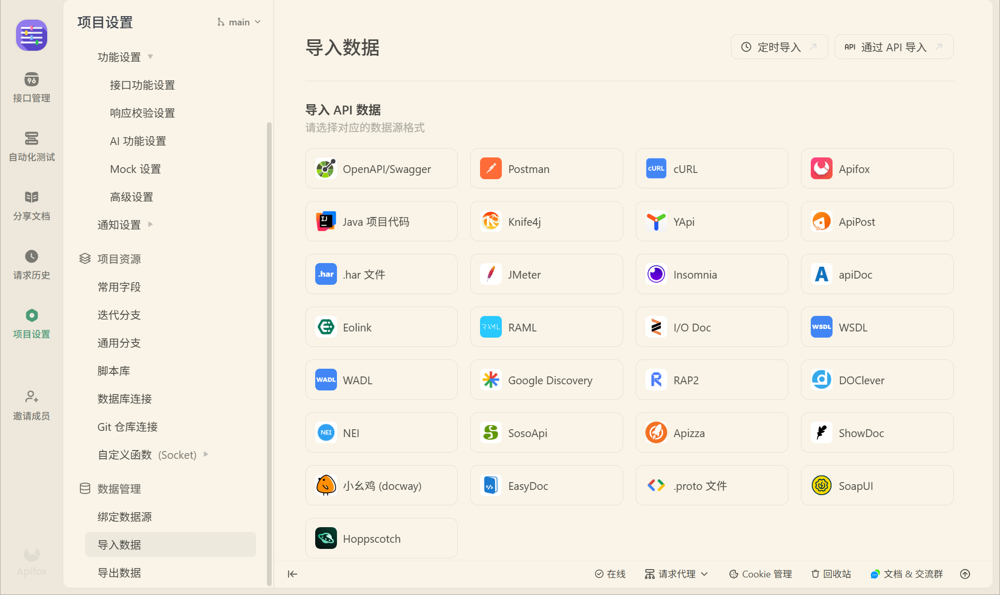

## 2. 配置环境（关键一步）

导入后默认可能停在「本地 Mock」环境，此时 URL 是
`http://127.0.0.1:4523/m1/...`（Apifox 云端 Mock），请求根本到不了本机 Tomcat。

正确做法：

1. 右上角环境下拉切换为 **开发环境**（或新建环境）；
2. 打开 `管理环境`，把该环境的 **前置 URL** 设为 `http://127.0.0.1:18080/monahub`；
3. 环境变量里同时确认 `baseUrl = http://127.0.0.1:18080/monahub`。

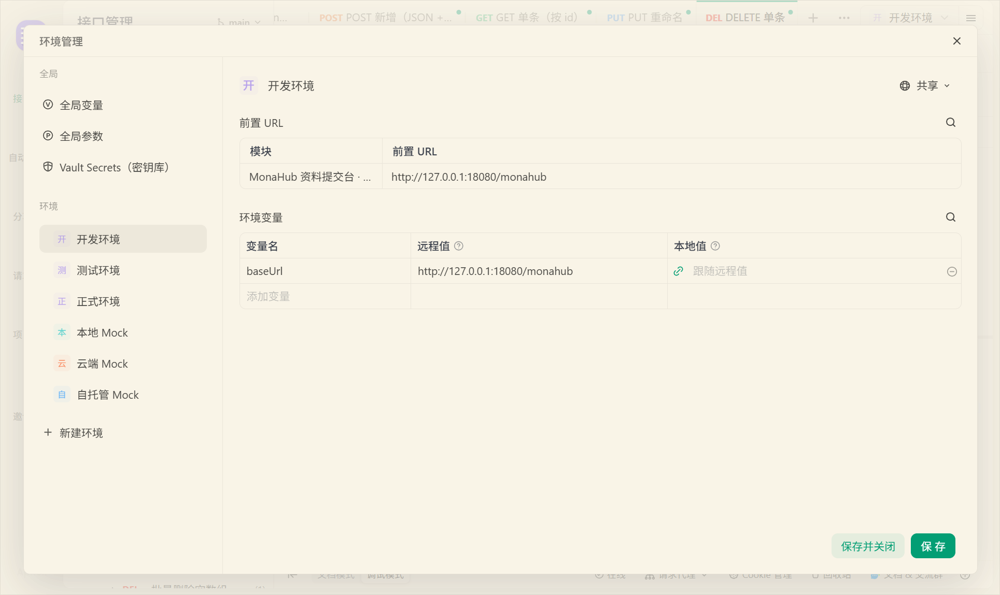

Apifox 导入时会把集合里的 `{{baseUrl}}` 收敛成「前置 URL + 路径」，所以日常只需要改这一个前置 URL。

切换成功后，请求行会显示：

```
http://127.0.0.1:18080/monahub  /api/files
```

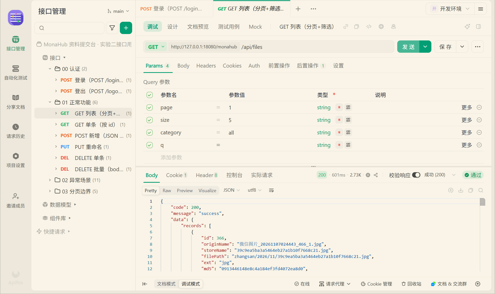

## 3. 认证：Session Cookie，不是 token

接口走 `LoginInterceptor` + HttpSession：

- 先发 `00 认证 → 登录`：`POST /login`，multipart 表单 `username=zhangsan`、`password=123456`；
- 登录成功返回 302，跳 `/files`，同时下发 `Set-Cookie: JSESSIONID=...`（Apifox 默认自动保存 Cookie）；
- 后续请求自动带 Cookie，`/api/**` 按会话识别当前用户。

Apifox 默认跟随重定向，所以界面最终显示的是 `/files` 的 200 HTML；点响应区的 **实际请求** 能看到
原始请求与重定向目标：

```
请求 URL:   POST http://127.0.0.1:18080/monahub/login
重定向 URL: GET  http://127.0.0.1:18080/monahub/files
Cookie:     JSESSIONID=...
Body: multipart/form-data  username=zhangsan  password=123456
```

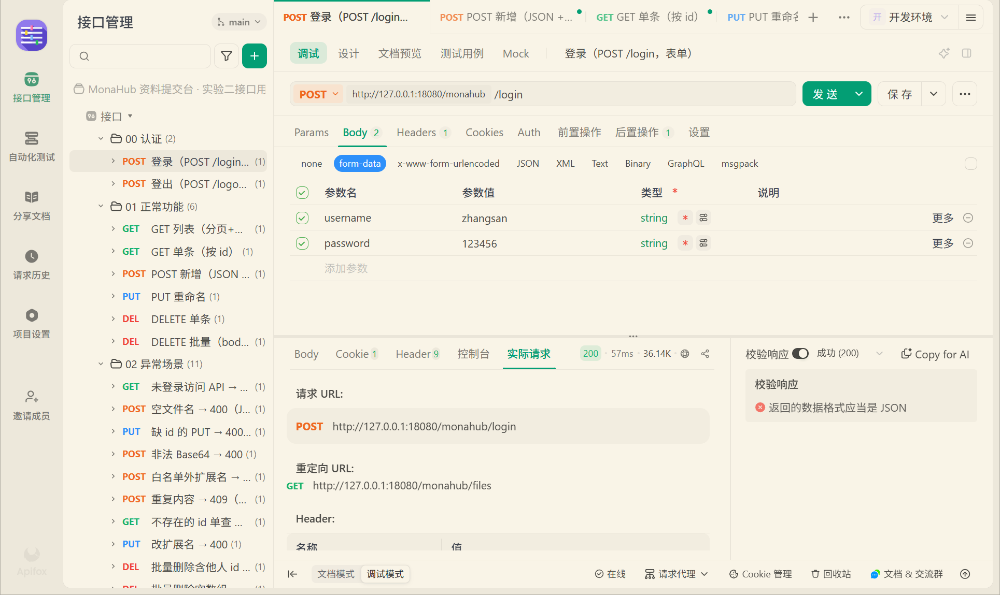

未登录访问 `/api/**` 返回 **401 JSON**（不是 302）：

```json
{"code":401,"message":"未登录"}
```

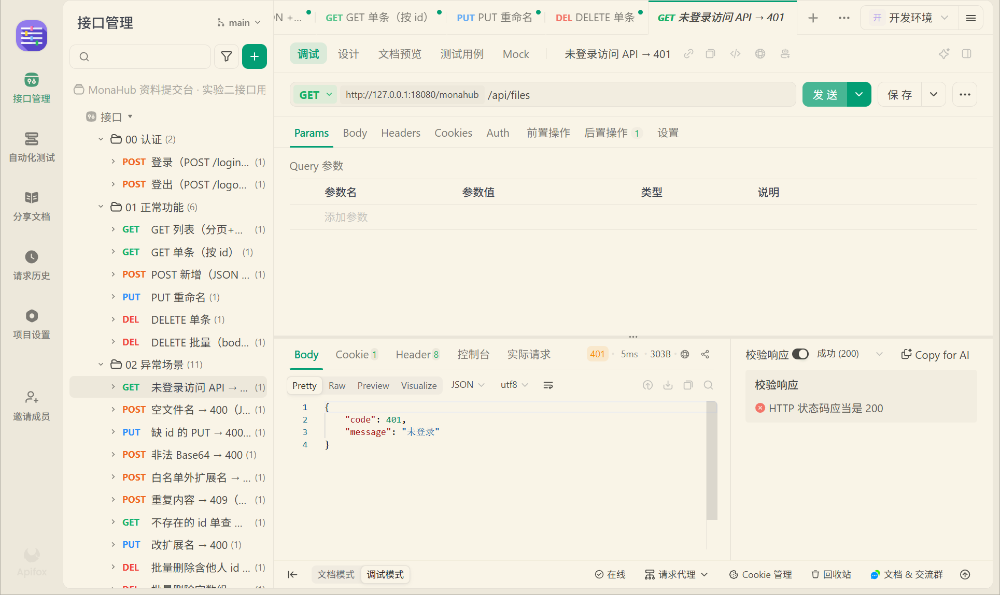

注意：Tomcat 重启后 Session 丢失，必须重跑一次登录。

## 4. 执行顺序与占位 id

集合里 `123 / 124 / 125` 是**占位 id**，直接跑 `01 正常功能` 会 404。推荐流程：

1. `00 认证 → 登录`
2. `01 正常功能 → POST 新增`：`content` 是 Base64 文件内容，每次换一段（同账号同内容会 409）
3. 从响应里取 `data.id`，填到 `GET 单条`、`PUT 重命名`、`DELETE 单条`、`批量 DELETE`
4. 再跑 `03 分页边界`（只读）与 `02 异常场景`
5. 跑完后 `00 认证 → 登出`，恢复未登录态（`02` 里的 401 用例要求先登出）

本次实测就是按这个顺序：新增得到 `id=539`，随后依次查询、重命名、删除。

| 步骤 | 请求 | 结果 |
|---|---|---|
| 新增 | `POST /api/files` | 200，`data.id=539` |
| 查询 | `GET /api/files/539` | 200，返回资源表示 |
| 重命名 | `PUT /api/files`（`{"id":539,"newName":"apifox改名"}`） | 200，`data:null` |
| 再查询 | `GET /api/files/539` | 200，`originName` 变为 `apifox改名.pdf` |
| 删除 | `DELETE /api/files/539` | 200，逻辑删除 |
| 再查询 | `GET /api/files/539` | 404「文件不存在或无权访问」 |

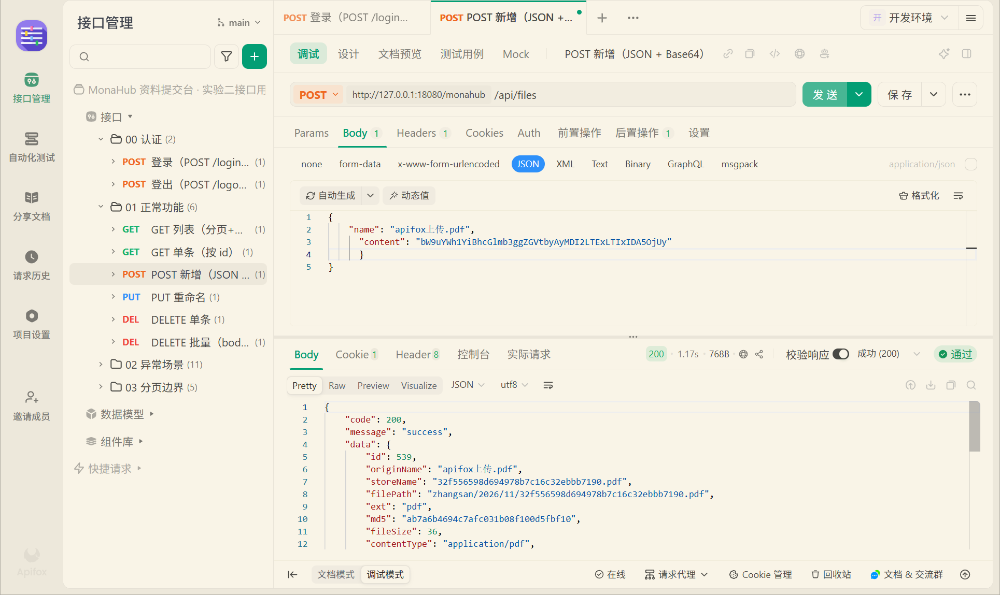

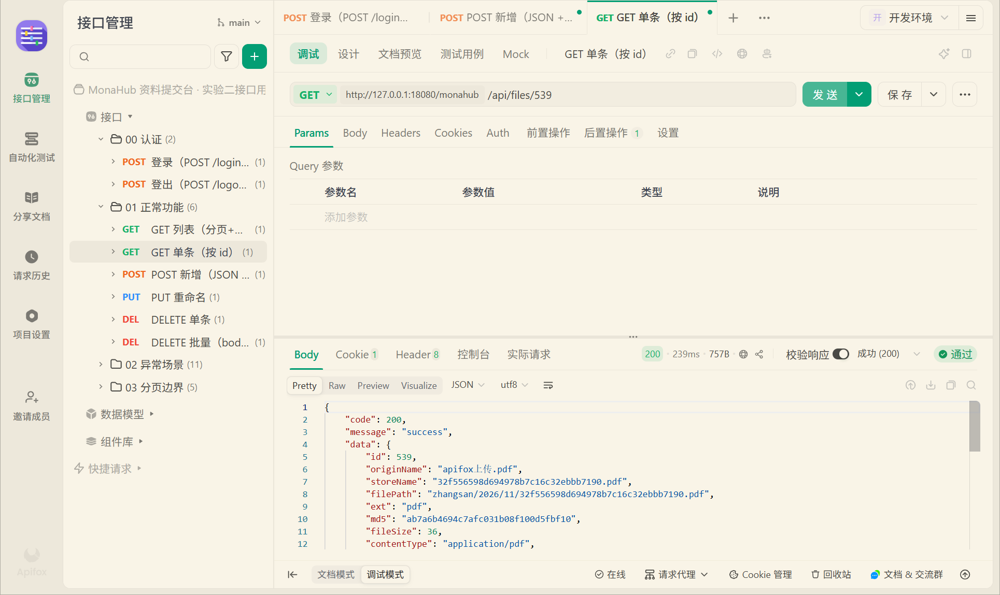

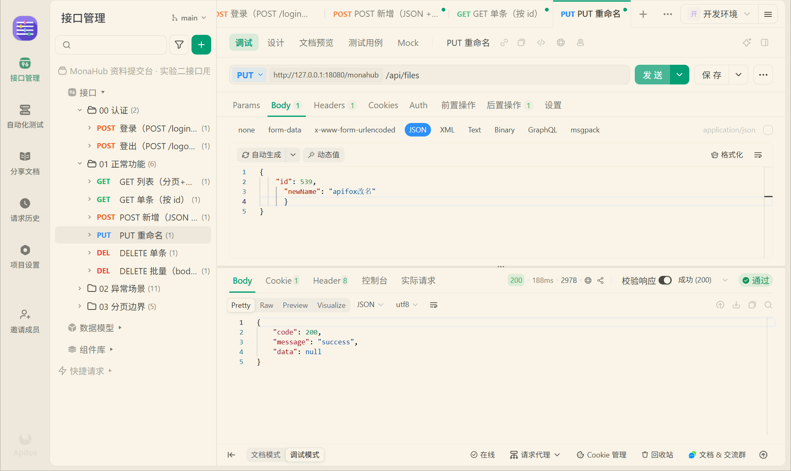

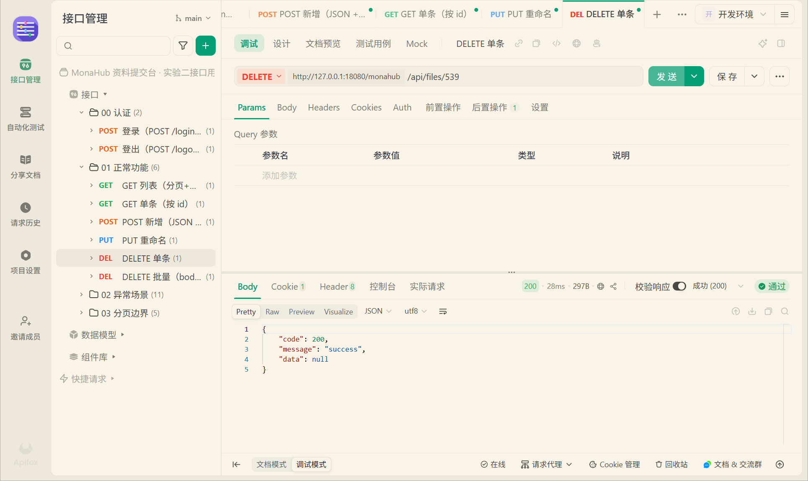

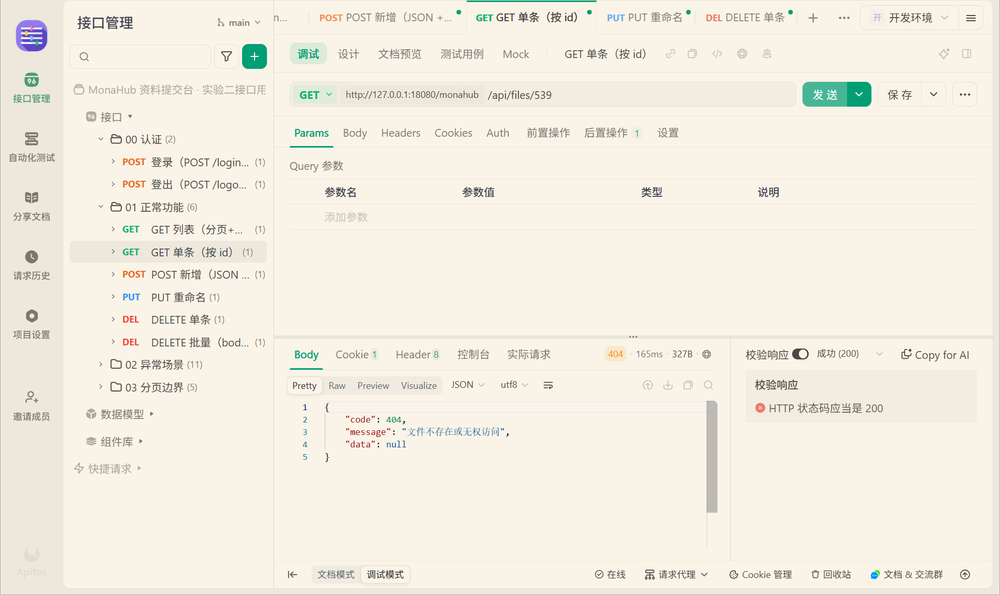

## 5. 异常与边界实测

| 用例 | 期望 | 本次实测 |
|---|---|---|
| `size=99999` | 夹紧为 50 | 200，`size=50` |
| `page=0` | 夹紧为 1 | 200，`current=1` |
| `size=0` | 夹紧为 1 | 200，`size=1` |
| `page=99999` | 回退末页 | 200，`current=2`（总页数 2） |
| 空文件名 | 400 | 400「文件名不能为空」 |
| 非法 Base64 | 400 | 400「content 不是合法的 Base64 编码」 |
| 白名单外扩展名（.exe） | 400 | 400，message 列出允许的扩展名 |
| 重复内容 | 409 | 409「与已有文件内容重复：apifox上传.pdf」 |
| 不存在的 id | 404 | 404「文件不存在或无权访问」 |
| 未登录访问 API | 401 JSON | 401 `{"code":401,"message":"未登录"}` |

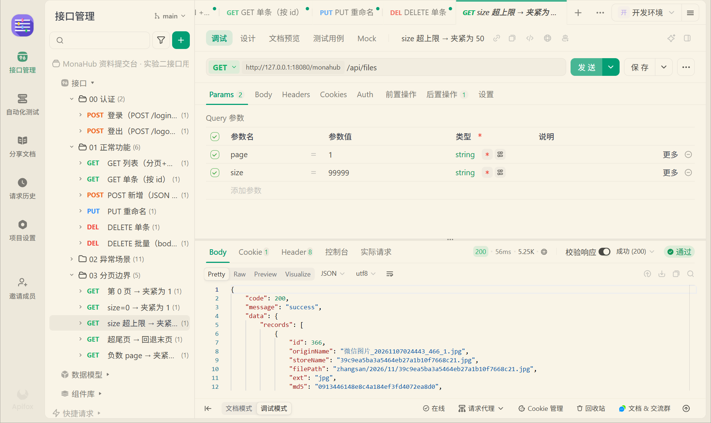

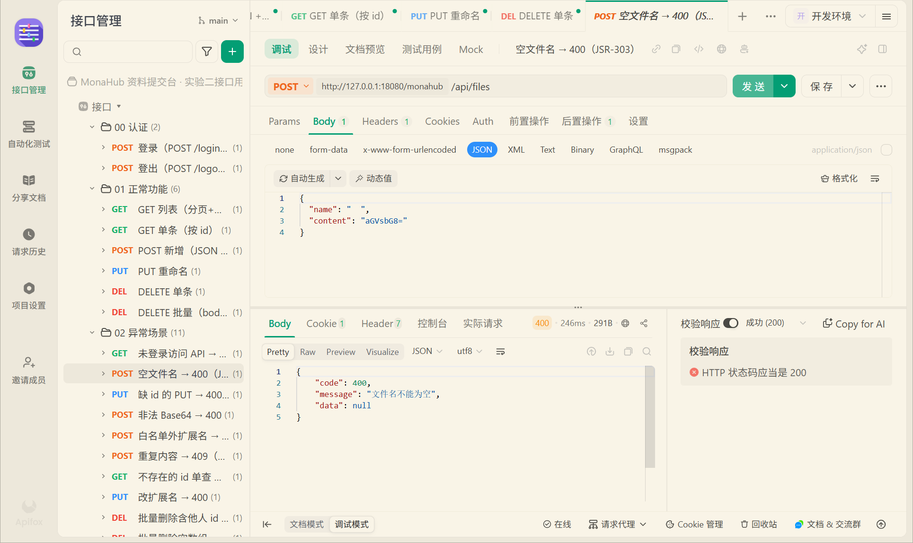

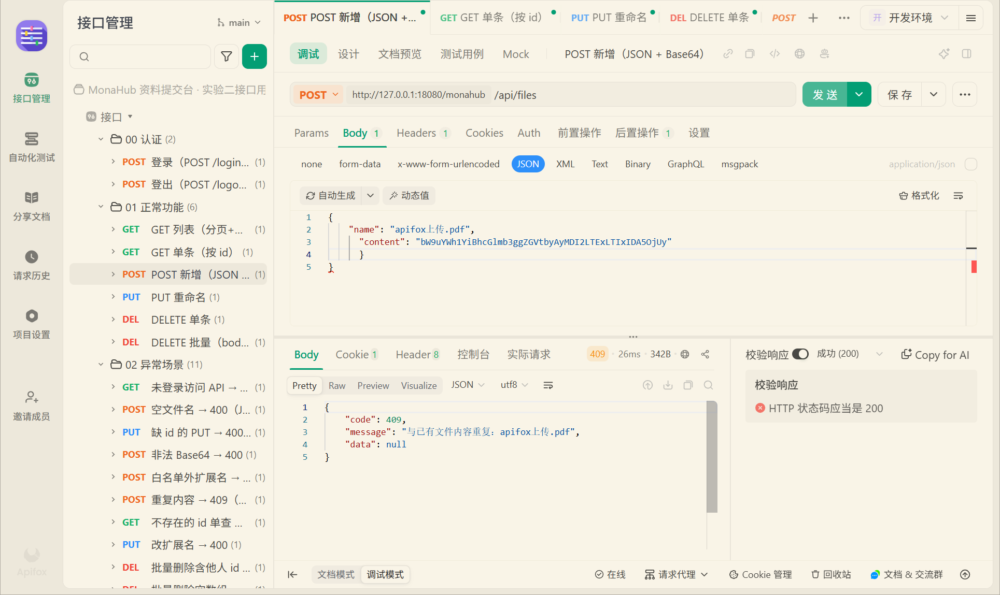

## 6. 做成自动化测试（可选）

`自动化测试 → 新建测试场景 → 添加步骤 → 从接口目录导入`，按第 4 节顺序勾选。

集合本身只带文字说明，没有断言脚本；需要在请求的 **后置操作** 里补：

- 提取变量：`POST 新增` → `$.data.id` 存为 `id`，其余请求用 `{{id}}`；
- 断言 HTTP 状态码（200/400/401/404/409）与 `$.code`；
- 分页断言 `$.data.size == 50`、`$.data.current >= 1`。

## 7. 常见问题

| 现象 | 原因 / 处理 |
|---|---|
| 全部 404 | 前置 URL 少了 `/monahub`，或应用不在 18080 |
| 请求打到 `127.0.0.1:4523` | 还停在「本地 Mock」环境，切到开发环境 |
| 重启后全部 401 | Session 丢失，重跑登录 |
| `POST 新增` 409 | 同账号同内容去重；换 `content` 的 Base64 |
| 400「请求体格式错误」 | raw body 的 Content-Type 不是 `application/json` |
| 批量删除 404 | 数组里有不存在/他人 id，整批不删（设计如此） |
| 登录返回 HTML | 正常：302 跟随到 `/files`；看 Cookie 与「实际请求」 |

## 8. 本次实测记录

- 日期：2026-11-21
- 环境：开发环境，前置 URL `http://127.0.0.1:18080/monahub`（本机 Tomcat + MySQL）
- 账号：`zhangsan / 123456`（`sql/init.sql` 种子）
- 覆盖：登录、列表、单条、新增、重命名、删除、删除后 404、分页边界 2 条、校验 2 条、重复 409、
  未登录 401；演示文件 `id=539`、`id=540` 均已逻辑删除
- 集合保存的定义仍使用占位 id（`123/124/125`），本次调试中的修改未保存
